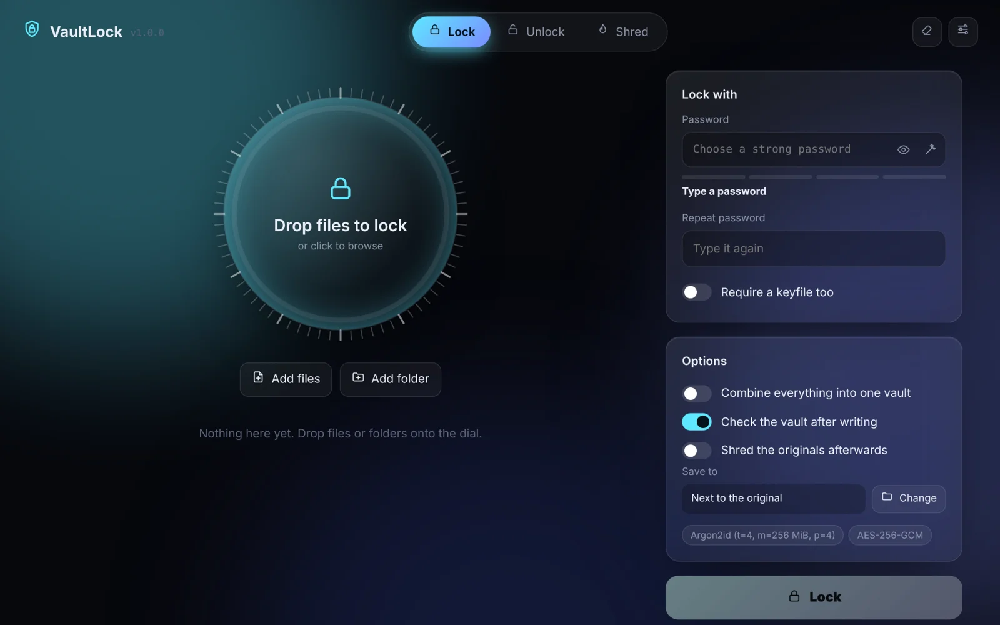

<div align="center">

# 🔐 VaultLock

**Local-first file and folder encryption with a modern desktop UI.**

### 🌐 [Live site: vaultlock-file-encrypter-and-decryp.vercel.app](https://vaultlock-file-encrypter-and-decryp.vercel.app/)


[](https://vaultlock-file-encrypter-and-decryp.vercel.app/)



</div>

Lock files and folders into authenticated `.vault` containers, preview them without writing to disk, and shred the originals once the vault is proven good. No account, no cloud, no telemetry.

> **Note:** the website above is a project page. VaultLock itself runs on your own computer, so your files and passwords never go to a server.

## ✨ Features

- **Authenticated encryption:** AES-256-GCM or ChaCha20-Poly1305. Tampering is detected before any plaintext is released.
- **Strong key derivation:** Argon2id (three profiles) or PBKDF2-SHA256 at 1M iterations, with a fresh 32-byte salt per vault.
- **Optional keyfile:** a second factor bound into the key.
- **Files and folders:** a whole folder becomes one vault, with no plaintext temp file.
- **Large files:** 1 MiB streamed chunks. A 2 GiB file peaks at about 97 MiB of RAM.
- **Secure viewer:** preview images, PDFs, audio, video and text decrypted in memory only.
- **Safe shredder:** 1, 3 or 7 passes, run only after the new vault is re-read and verified.
- **Live progress:** percent, MB/s and ETA. Cancel any time and originals stay intact.
- **Password tools:** pattern-aware strength meter and passphrase generator.
- **Command line:** lock, unlock, verify, inspect, rekey, shred, keygen.
- **Fully offline:** no CDN, no analytics. It only listens on `127.0.0.1`.

## 📐 Specifications

| | |
|---|---|
| Ciphers | AES-256-GCM, ChaCha20-Poly1305 |
| KDF | Argon2id: 64 MiB / 256 MiB (default) / 1 GiB. PBKDF2: 1,000,000 iterations |
| Container | 100-byte header, encrypted metadata, then sealed 1 MiB chunks ([FORMAT.md](docs/FORMAT.md)) |
| Integrity | Every chunk authenticates the header, its index and a last-chunk flag |
| Speed | AES-GCM 355 / 454 MB/s, ChaCha20 450 / 480 MB/s (encrypt / decrypt, 2-core VM) |
| Runtime | Python 3.11 to 3.13 |

## 🚀 Quick start

Needs Python 3.11+ from [python.org](https://www.python.org/downloads/). On Windows, tick *Add python.exe to PATH*.

```bash
git clone https://github.com/YOUR-USERNAME/VaultLock.git
cd VaultLock
```

| System | Run |
|---|---|
| Windows | double-click `start_vaultlock.bat` (or `.\start_vaultlock.bat`) |
| macOS / Linux | `sh start_vaultlock.sh` |

The launcher builds its own environment and opens VaultLock in your browser.

Or install it as a command:

```bash
pip install "git+https://github.com/YOUR-USERNAME/VaultLock.git"
vaultlock gui
```

## 💻 Command line

```bash
vaultlock keygen main.key
vaultlock lock  ~/Documents/taxes -o ~/Vaults --keyfile main.key --verify
vaultlock unlock ~/Vaults/taxes.vault --keyfile main.key -o ~/Documents
vaultlock rekey ~/Vaults/taxes.vault --replace
```

Passwords come from a hidden prompt or `VAULTLOCK_PASSWORD`, never from arguments.

## 🎯 Use cases

Personal documents, USB sticks and transfers, backups to untrusted storage, and project files on shared or lost laptops.

## 🧰 Built with

| Layer | Tool |
|---|---|
| Language | Python 3.11+ |
| Cryptography | `cryptography` (AES-GCM, ChaCha20, HKDF, HMAC) |
| Password hashing | `argon2-cffi`, PBKDF2 |
| Local API | Flask |
| Desktop window | PyWebView (optional) |
| Front end | HTML5, CSS3, vanilla JavaScript, inline SVG |
| Testing | pytest, Playwright |
| CI | GitHub Actions |
| Website | Static HTML on Vercel |

## 🏗️ Structure

```
vaultlock/
  core/       cryptography: format, streaming AEAD, KDF, keyfile, archive, engine
  services/   shredder, strength meter, job runner, file browser
  server/     localhost-only Flask API
  web/        HTML, CSS and JS interface
docs/         FORMAT.md, SECURITY.md
tests/        pytest suite
site/         landing page (deployed on Vercel)
```

## ⚠️ Honest limits

- There is **no password recovery**. Back up your keyfile offline.
- It cannot protect you from malware or a keylogger on your PC.
- Shredding is unreliable on SSDs and cloud-synced folders. Use full-disk encryption too.
- It has not had an independent security audit.

## 🛠️ Development

```bash
pip install -e ".[dev]"
python -m pytest -q
```

## 📄 License

MIT. See [LICENSE](LICENSE).
